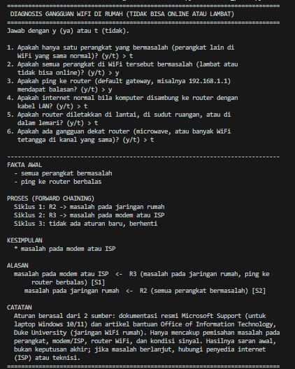
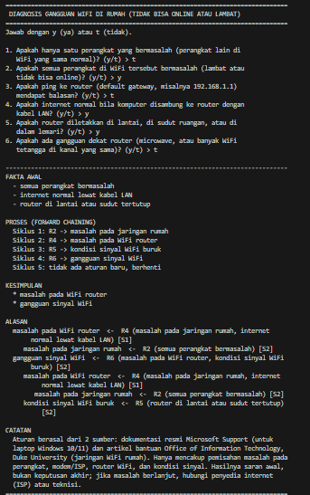
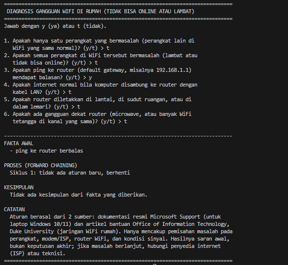

SISTEM PAKAR DIAGNOSIS GANGGUAN WIFI DI RUMAH

Menggunakan Metode Forward Chaining

- Nama: Rosida Asri Ardiani
- NIM: F1D02410142
- Mata Kuliah: Kecerdasan Buatan

1. Deskripsi Proyek

Sistem pakar ini dibuat untuk membantu mengidentifikasi kemungkinan penyebab gangguan WiFi di rumah, seperti koneksi internet yang lambat atau tidak bisa digunakan.

Pengguna akan menjawab beberapa pertanyaan berdasarkan kondisi jaringan yang dialami. Jawaban tersebut kemudian diproses menggunakan aturan IF-THEN untuk menghasilkan kesimpulan mengenai kemungkinan penyebab gangguan.

Sistem ini menggunakan metode Forward Chaining, yaitu proses penalaran yang dimulai dari fakta awal kemudian menghasilkan kesimpulan berdasarkan aturan yang tersedia.

2. Tujuan Sistem

1. Mengidentifikasi kemungkinan penyebab gangguan WiFi di rumah.
2. Membedakan gangguan yang berasal dari perangkat, modem/ISP, dan router WiFi.
3. Menerapkan metode Forward Chaining dalam sistem pakar sederhana.
4. Menampilkan kesimpulan beserta alasan aturan yang digunakan.

3. Teknologi yang Digunakan

- Bahasa pemrograman: Python
- Versi: Python 3
- Metode: Forward Chaining
- Basis pengetahuan: JSON
- Editor: Visual Studio Code

4. Struktur Repository

ai-tugas5-FID02410142/
│
├── sistem_pakar.py
├── kb_wifi.json
├── README.md
│
└── screenshot/
    ├── kasus1.png
    ├── kasus2.png
    └── kasus3.png

5. Daftar Sumber

S1. Microsoft Support

- Judul: Fix Wi-Fi connection issues in Windows
- Penerbit: Microsoft Support
- URL: https://support.microsoft.com/en-us/help/10741
- Tanggal akses: 10 November 2026

S2. Duke University

- Judul: Home and Wireless Network Tips and Troubleshooting
- Penerbit: Office of Information Technology, Duke University
- URL: https://oit.duke.edu/help/articles/kb0032708/
- Tanggal akses: 10 November 2026

Kedua sumber tersebut digunakan sebagai dasar penyusunan aturan untuk mengidentifikasi kemungkinan gangguan pada perangkat, jaringan rumah, modem/ISP, router WiFi, dan kondisi sinyal.

6. Basis Pengetahuan dan Aturan IF-THEN

Sistem memiliki enam aturan yang digunakan untuk melakukan proses penalaran.

ID| Kondisi (IF)| Kesimpulan (THEN)| Sumber
R1| Hanya satu perangkat bermasalah| Masalah pada perangkat| S1
R2| Semua perangkat bermasalah| Masalah pada jaringan rumah| S2
R3| Masalah pada jaringan rumah AND ping ke router berbalas| Masalah pada modem atau ISP| S1
R4| Masalah pada jaringan rumah AND internet normal lewat kabel LAN| Masalah pada WiFi router| S1
R5| Router di lantai atau sudut tertutup OR ada gangguan dekat router| Kondisi sinyal WiFi buruk| S2
R6| Masalah pada WiFi router AND kondisi sinyal WiFi buruk| Gangguan sinyal WiFi| S2

Penjelasan aturan:

- R1 digunakan untuk mengidentifikasi kemungkinan masalah pada satu perangkat.
- R2 digunakan ketika seluruh perangkat mengalami gangguan pada jaringan yang sama.
- R3 digunakan untuk mengidentifikasi kemungkinan masalah pada modem atau ISP.
- R4 digunakan ketika koneksi internet melalui kabel LAN normal, tetapi koneksi WiFi bermasalah.
- R5 digunakan untuk mengidentifikasi kondisi yang dapat mengganggu kualitas sinyal WiFi.
- R6 menggabungkan hasil aturan R4 dan R5 untuk menghasilkan kesimpulan gangguan sinyal WiFi.

Aturan R2, R5, dan hasil aturan lainnya memungkinkan sistem menghasilkan fakta baru yang digunakan kembali oleh aturan berikutnya.

7. Metode Forward Chaining

Forward Chaining merupakan metode penalaran yang bekerja dengan memulai proses dari fakta awal untuk memperoleh kesimpulan berdasarkan aturan yang tersedia.

Metode ini dipilih karena sistem diagnosis gangguan WiFi dimulai dari gejala atau kondisi yang dialami pengguna.

Langkah-langkah proses Forward Chaining:

1. Program membaca basis pengetahuan dari file "kb_wifi.json".
2. Program menampilkan pertanyaan kepada pengguna.
3. Jawaban ya disimpan sebagai fakta awal.
4. Sistem mencocokkan fakta dengan kondisi pada setiap aturan.
5. Jika kondisi aturan terpenuhi, hasilnya ditambahkan ke memori.
6. Fakta baru digunakan kembali untuk memeriksa aturan berikutnya.
7. Proses berhenti ketika tidak ada aturan baru yang dapat dijalankan.
8. Program menampilkan kesimpulan dan alasan berdasarkan aturan yang digunakan.

Contoh proses perhitungan manual:

Misalnya pengguna memberikan fakta berikut:

- Semua perangkat bermasalah.
- Ping ke router berbalas.

Proses penalaran:

Siklus 1:

R2:

IF semua perangkat bermasalah

THEN masalah pada jaringan rumah.

Aturan R2 terpenuhi sehingga menghasilkan fakta baru berupa masalah pada jaringan rumah.

Siklus 2:

R3:

IF masalah pada jaringan rumah AND ping ke router berbalas

THEN masalah pada modem atau ISP.

Kedua kondisi terpenuhi sehingga sistem menghasilkan kesimpulan masalah pada modem atau ISP.

Siklus 3:

Tidak ada aturan baru yang terpenuhi sehingga proses dihentikan.

Hasil akhir:

Kemungkinan masalah pada modem atau ISP.

8. Cara Menjalankan Program

Persyaratan:

- Python 3 sudah terinstal.
- File "sistem_pakar.py" dan "kb_wifi.json" berada dalam folder yang sama.

Langkah menjalankan program:

1. Buka folder proyek menggunakan Visual Studio Code.
2. Buka terminal.
3. Jalankan perintah berikut:

python sistem_pakar.py

4. Jawab pertanyaan dengan:
   - "y" untuk Ya.
   - "t" untuk Tidak.
5. Program akan menampilkan fakta awal, proses Forward Chaining, kesimpulan, dan alasan aturan yang digunakan.

9. Pengujian Program

Pengujian dilakukan menggunakan beberapa kombinasi jawaban untuk mengetahui apakah sistem dapat menghasilkan kesimpulan sesuai aturan yang telah dibuat.

Kasus 1: Kemungkinan masalah pada modem atau ISP

Fakta:

- Semua perangkat bermasalah.
- Ping ke router berbalas.

Hasil:

- R2 menghasilkan masalah pada jaringan rumah.
- R3 menghasilkan masalah pada modem atau ISP.

Kesimpulan: Masalah pada modem atau ISP.

Kasus 2: Masalah pada WiFi router dan gangguan sinyal WiFi

Fakta:

- Semua perangkat bermasalah.
- Internet normal lewat kabel LAN.
- Router diletakkan di lantai atau sudut tertutup.

Hasil:

- R2 menghasilkan masalah pada jaringan rumah.
- R4 menghasilkan masalah pada WiFi router.
- R5 menghasilkan kondisi sinyal WiFi buruk.
- R6 menghasilkan gangguan sinyal WiFi.

Kesimpulan:

- Masalah pada WiFi router.
- Gangguan sinyal WiFi.

Kasus 3: Tidak menghasilkan kesimpulan

Kasus ini menggunakan jawaban tidak pada seluruh pertanyaan.

Hasil yang diharapkan:

Tidak ditemukan kesimpulan karena tidak ada aturan yang kondisi-kondisinya terpenuhi.

## 10. Screenshot Pengujian

### Kasus 1 – Masalah pada modem atau ISP

### Kasus 2 – Masalah pada WiFi router dan gangguan sinyal WiFi

### Kasus 3 – Tidak ditemukan kesimpulan

11. Batas Keberlakuan Sistem

Pengetahuan yang digunakan dalam sistem ini berasal dari dokumentasi resmi Microsoft Support untuk laptop Windows 10/11 dan artikel bantuan Office of Information Technology, Duke University mengenai jaringan WiFi rumah. Sistem hanya mencakup identifikasi awal gangguan pada perangkat, modem/ISP, router WiFi, dan kondisi sinyal berdasarkan enam aturan yang telah disusun. Sistem tidak melakukan pemeriksaan jaringan secara langsung sehingga hasil yang diberikan hanya berupa kemungkinan penyebab atau saran awal, bukan keputusan akhir. Jika masalah tetap berlanjut, pengguna disarankan menghubungi penyedia layanan internet (ISP) atau teknisi.

12. Penggunaan Alat Bantu AI

Dalam pengerjaan tugas ini, saya menggunakan AI sebagai alat bantu belajar untuk memahami konsep sistem pakar dan metode Forward Chaining. AI juga digunakan untuk membantu memberikan penjelasan ketika terdapat bagian materi atau kode program yang belum saya pahami. Sementara itu, penyusunan aturan, pengerjaan program, pengujian, dan penyusunan dokumentasi dilakukan oleh saya sendiri. Setiap bagian yang dikerjakan tetap saya pelajari dan pahami agar dapat menjelaskan cara kerja sistem yang dibuat.
